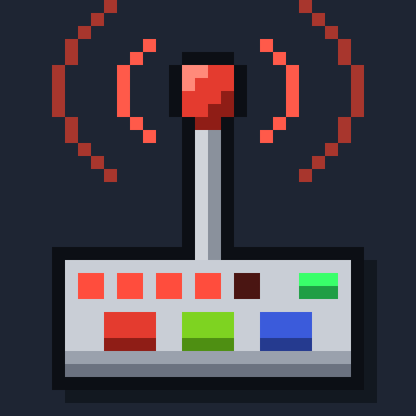
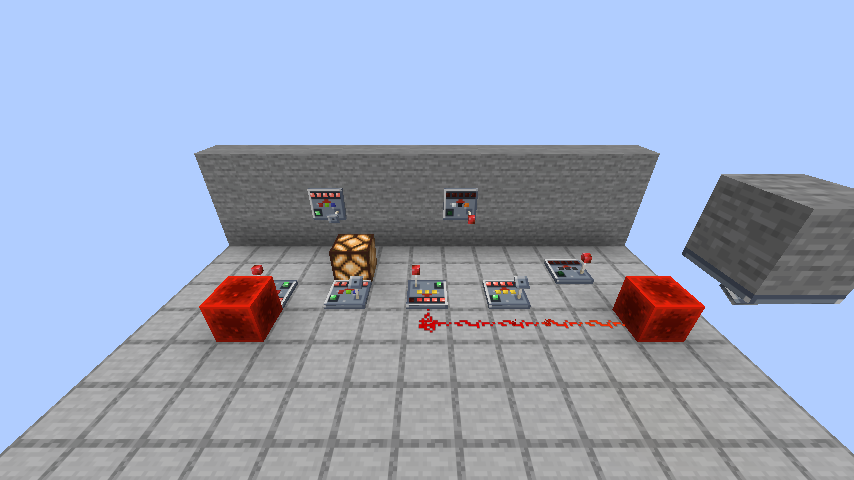
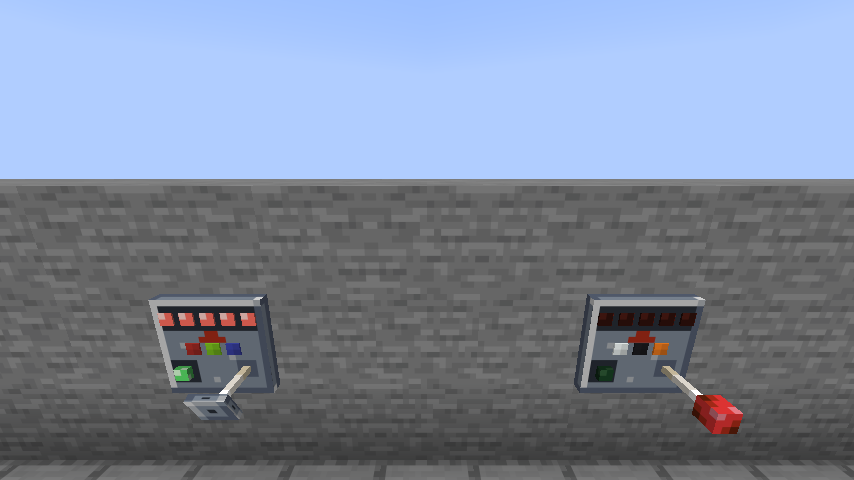

<p align="center"></p>

<h1 align="center">Wireless Redstone</h1>

<p align="center">
Send redstone signals without wires. Small panels, keyed to a channel with three dyes,
carry full signal strength across any distance in a dimension.
</p>

<p align="center">
<a href="https://github.com/wbellman/wireless-redstone/actions/workflows/build.yml"></a>


<a href="COPYING.LESSER"></a>
</p>



## Features

- **Wireless Panel** — one block, two modes: *transmitter* and *receiver*. Mounts on floors,
  walls and ceilings.
- **Dye channels** — three dye slots per panel, in order: 4,096 channels, shown as colored
  pips on the panel.
- **Analog signal** — strength 0–15 carries across; a receiver outputs the strongest
  transmitter on its channel.
- **Predictable timing** — a fixed 2-game-tick delay (one repeater tick) at any distance.
- **Safe feedback loops** — wiring a receiver back into its own transmitter makes a clock, not
  a crash.
- **At-a-glance status** — a green antenna light while the channel carries a signal, and a
  five-LED strength gauge.
- **Wireless Remote** — copy a panel's channel, then right-click anywhere for a one-second pulse.
- **Server friendly** — never loads chunks; optional range limit for servers.

## Requirements

| | |
|---|---|
| Minecraft | 26.3 |
| Mod loader | [Fabric Loader](https://fabricmc.net/use/) |
| Dependencies | [Fabric API](https://modrinth.com/mod/fabric-api) |
| Install on | **Both** the server and every player's client |

The panel and remote are new blocks and items with their own models, so players need the mod
to join a server that has it. The same jar works on both sides.

## Getting started

1. **Craft two Wireless Panels.**

   ```
   .  T  .      T = Redstone Torch
   .  Q  .      Q = Nether Quartz
   I  I  I      I = Iron Ingot
   ```

2. **Place them.** New panels are transmitters (red bulb on the antenna). Right-click one with an
   empty hand to make it a receiver (dish antenna).
3. **Set a channel.** Right-click each panel with three dyes — the same colors, in the same order.
   Sneak-right-click with an empty hand to take the last dye back out.
4. **Power the transmitter.** The receiver outputs the same strength two game ticks later.

### Which side does what

| | Floor panel | Wall or ceiling panel |
|---|---|---|
| **Transmitter reads** | The block its arrow points at | The block it is mounted on, and dust running into it |
| **Receiver outputs** | Into the block its arrow points at (strongly, like a repeater) | Like a lever: strongly powers the block it is mounted on, weakly powers its neighbors |

A floor panel's arrow points the way you were looking when you placed it — so face the source
when placing a transmitter, and face the target when placing a receiver. Redstone dust only
connects to a panel on a side that does something.



### Wireless Remote

Craft a Wireless Panel above a Stick. Right-click a panel to copy its channel, then right-click
anywhere else to send a full-strength pulse for one second (one-second cooldown). The tooltip
shows the remote's channel.

## Controls

| Action on a panel | Effect |
|---|---|
| Right-click, empty hand | Toggle transmitter / receiver |
| Right-click with a dye | Put the dye in the next empty slot (the dye is used up) |
| Sneak-right-click, empty hand | Take the last dye back out |
| Right-click with a remote | Copy the panel's channel to the remote |
| Break it | Drops the panel and any dyes in it |

## Range, dimensions and chunks

- Range is unlimited within a dimension. Channels do not cross dimensions: the same colors in
  the Overworld and the Nether are separate channels.
- Channels are public — anyone who uses the same three colors is on the same channel.
- The mod never force-loads chunks. A transmitter in an unloaded chunk keeps holding its last
  signal, and a receiver catches up as soon as its chunk loads.

## Server configuration

`config/wireless_redstone.json` is created on first start:

```json
{
  "maxRange": 0
}
```

| Key | Meaning |
|---|---|
| `maxRange` | Maximum distance in blocks between a transmitter (or remote) and a receiver. `0` = unlimited. |

Players do not need a config file.

## More documentation

- [How it works](docs/how-it-works.md) — the full rules: channels, signal timing, chunk
  loading, stale data.
- [Development](docs/development.md) — building, testing, and the art and model pipeline.
- [Changelog](CHANGELOG.md)
- [Contributing](CONTRIBUTING.md)

## Building from source

Needs JDK 25 or newer. Everything else (Gradle, Minecraft, Fabric) is downloaded on first build.

```bash
./gradlew build        # jar in build/libs/
./gradlew runClient    # play with the mod
```

## License

Copyright © 2026 wbellman.

Wireless Redstone is free software: you can redistribute it and/or modify it under the terms of
the GNU Lesser General Public License as published by the Free Software Foundation, either
version 3 of the License, or (at your option) any later version. See [COPYING.LESSER](COPYING.LESSER)
and [COPYING](COPYING).

The art (textures, icon and Aseprite sources) is covered by the same license.

Developed with AI assistance.
